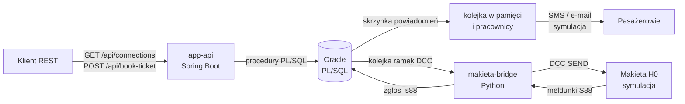

# SignaRail 87

[](https://github.com/leszekmac/SignaRail87/actions/workflows/ci.yml)

**SignaRail 87 to cyfrowy bliźniak makiety kolejowej w skali 1:87 (H0): system, w którym rozkład jazdy, sprzedaż miejsc i sterowanie ruchem przez protokół DCC opierają się na logice transakcyjnej w Oracle PL/SQL.**

Baza danych jest tu sercem systemu, a nie magazynem. Reguły biznesowe, gwarancja braku overbookingu, wyszukiwanie połączeń, zależności ruchowe i kodowanie ramek DCC żyją w pakietach PL/SQL. Java i Python są cienkimi warstwami integracyjnymi.

> Prywatny projekt portfolio, niezwiązany z żadnym przewoźnikiem ani zarządcą infrastruktury. Dane są fikcyjne, a interfejs sprzętowy jest symulowany.

## Co pokazuje projekt

| Obszar | Rozwiązanie | Gdzie |
|---|---|---|
| **Overbooking** | `SELECT ... FOR UPDATE`, ponowne sprawdzenie po blokadzie i unikalny klucz na poziomie odcinka trasy | [`pkg_rezerwacja.pkb`](database/packages/pkg_rezerwacja.pkb) |
| **Wyszukiwanie połączeń** | Algorytm rundowy (wariant RAPTOR) z przesiadkami: 240 ms wobec 352 s dla rekurencyjnego CTE przy 2,19 mln postojów | [`pkg_rozklad.pkb`](database/packages/pkg_rozklad.pkb) |
| **Wydajność** | Partycje miesięczne, indeksy lokalne i analiza planów z realnego wykonania: 10 853 → 3 bloki | [`database/perf/`](database/perf/README.md) |
| **Sterowanie ruchem** | Dobór składu do pogody, długości toru, uciągu i bilansu prądu, zamykanie przebiegów, stop awaryjny | [`pkg_h0_controller.pkb`](database/packages/pkg_h0_controller.pkb) |
| **Protokół DCC** | Ramki NMRA S-9.2 kodowane w PL/SQL i weryfikowane niezależnym dekoderem w Pythonie | [`dcc.py`](makieta-bridge/makieta_bridge/dcc.py) |
| **Asynchroniczność** | Transactional outbox, kolejka z backpressure, ponowienia i dzierżawa przeżywająca awarię procesu | [`NotificationDispatcher`](app-api/src/main/java/pl/signarail/api/notifications/NotificationDispatcher.java) |
| **Audyt** | Dziennik powypadkowy zmian rozjazdów i bloków, wyłącznie do dopisywania | [`03_integracja.sql`](database/schema/03_integracja.sql) |
| **Testy** | 105 testów, w tym 40 równoległych klientów na prawdziwym Oracle, uruchamianych w CI | [Testy](#testy) |

## Architektura



Przykład sprzężenia między warstwami: czujnik S88 melduje zajęcie toru, który nie należy do żadnego przebiegu. Baza blokuje blok, anuluje niewysłane polecenia i kolejkuje rozgłoszeniowy stop awaryjny. Ta sama transakcja zapisuje opóźnienie powiązanego kursu rozkładowego i tworzy powiadomienia dla jego pasażerów.

## Uruchomienie

Wymagany jest Docker z Compose. Pierwszy start pobiera obraz Oracle (około 2 GB).

```bash
docker compose up -d --build --wait
scripts/demo.sh
docker compose logs makieta-bridge
```

Swagger UI: <http://localhost:8080/swagger-ui/index.html>

`demo.sh` zużywa kurs nr 1 na makiecie, więc przed ponownym uruchomieniem wyzeruj stan: `docker compose down -v`.

### Fragment działania

```text
=== Polaczenie Rzeszow -> Gdansk
2026-11-07T06:00:00 -> 2026-11-07T14:50:00, przesiadki: 2, 530 min
   IC3510   Rzeszów Główny 06:00 -> Kraków Główny 07:45
   TLK1610  Kraków Główny 08:15 -> Warszawa Centralna 11:50
   EIP4100  Warszawa Centralna 12:15 -> Gdańsk Główny 14:50

=== Proba sprzedazy tego samego miejsca na nakladajacym sie odcinku
HTTP 409  "Miejsce 43 jest zajete na tym odcinku"  (ORA-20011)
```

```text
[DCC SEND] Rozjazd R2 -> PROSTO [83 FF 7C]
[DCC SEND] Adres lokomotywy: 3 -> Wlacz swiatla czolowe (F0) -> Wlacz oswietlenie wagonow (F1) [03 91 92]
[DCC SEND] Adres lokomotywy: 3 -> Ustaw predkosc: 43 km/h (skalowane do 1:87) [03 3F BD 81]
[S88] czujnik 1: zajety
[S88] czujnik 3: zajety
[S88] czujnik 1: wolny
[S88] czujnik 6: zajety
[S88] czujnik 3: wolny
[DCC SEND] Adres lokomotywy: 3 -> Stop na torze docelowym [03 3F 80 BC]
```

## API

| Metoda | Ścieżka | Działanie |
|---|---|---|
| `GET` | `/api/stations` | Lista stacji |
| `GET` | `/api/connections?from&to&departure&maxTransfers&limit` | Wyszukiwanie połączeń (`PKG_ROZKLAD.znajdz_polaczenie`) |
| `POST` | `/api/book-ticket` | Zakup biletu; nagłówek `Idempotency-Key` czyni ponowienia bezpiecznymi |
| `DELETE` | `/api/tickets/{numer}` | Anulowanie i zwolnienie miejsca |
| `POST` | `/api/delays` | Zgłoszenie opóźnienia i kolejkowanie powiadomień |
| `GET` | `/api/notifications/stats` | Stan kolejki powiadomień |
| `POST` | `/api/layout/courses/{id}/prepare` | Dobór składu do warunków |
| `POST` | `/api/layout/courses/{id}/start` | Zamknięcie przebiegu i wysłanie poleceń DCC |
| `GET` | `/api/layout/courses`, `/blocks`, `/commands`, `/power` | Stan makiety i bilans prądu |

Błędy mają format RFC 9457. Kody z [`PKG_BLEDY`](database/packages/pkg_bledy.pks) są mapowane na statusy HTTP, np. zajęte miejsce to `409`, a wiersz zablokowany przez inną sprzedaż to `423`.

## Kluczowe decyzje

### Jak działa ochrona przed overbookingiem

Bilet zajmuje wiersze `(kurs, miejsce, odcinek)` w tabeli `rezerwacje_odcinki`. Dzięki temu to samo miejsce można sprzedać na stykających się trasach A–B i B–C, a trasy nakładające się wykluczają się nawzajem. Ochrona ma dwie warstwy:

1. **Blokada wiersza miejsca.** `FOR UPDATE WAIT 3` dla wskazanego miejsca, `FOR UPDATE SKIP LOCKED` dla wyboru automatycznego, aby równolegli klienci brali różne miejsca zamiast czekać w kolejce.
2. **Klucz główny na odcinku.** Baza fizycznie odrzuci duplikat, nawet gdyby logika aplikacji zawiodła.

**Sprawdzenie zajętości musi nastąpić po zdobyciu blokady, osobnym zapytaniem.** Warunek `NOT EXISTS` w kursorze `FOR UPDATE` czyta obraz danych sprzed blokady, a rezerwacja innej sesji nie zmienia wiersza miejsca, więc Oracle nie uruchomi zapytania ponownie. Potwierdza to eksperyment: po usunięciu tego kroku od 4 do 15 z 40 równoległych klientów dostawało błąd mimo wolnych miejsc. Do podwójnej sprzedaży nie doszło, bo zatrzymał ją klucz główny.

Świadomy kompromis: blokada dotyczy miejsca w wagonie, a nie miejsca na konkretnym kursie, więc zakupy tego samego miejsca na różne dni też się szeregują. Blokada trwa tyle co jedna krótka transakcja, a tabela miejsc per kurs oznaczałaby wiersze dla każdego kursu i miejsca przez cały rok.

### Dlaczego wyszukiwanie to nie rekurencyjny CTE

CTE musi rozwinąć wszystkie ścieżki, zanim je porówna, więc koszt gwałtownie rośnie z liczbą przesiadek. Algorytm rundowy trzyma dla każdej stacji najlepszy czas dotarcia i od razu odcina gorsze gałęzie. Rekurencyjny CTE jest za to użyty tam, gdzie pasuje: do znajdowania trasy w małym grafie torów makiety.

### Granica transakcji należy do wywołującego

Pakiety nie wykonują `COMMIT`. Dzięki temu `@Transactional` w API decyduje o transakcji, procedury można łączyć, a utPLSQL wycofuje zmiany po każdym teście. Wyjątkiem jest `pkg_bledy.zapisz`: transakcja autonomiczna, żeby wpis o błędzie przetrwał `ROLLBACK`.

### Powiadomienia nie giną

Sama kolejka w pamięci traci zadania przy restarcie, więc zdarzenie zapisuje się w `powiadomienia` w tej samej transakcji co opóźnienie, a kolejka jest tylko buforem. Pobieranie tylko tylu wierszy, ile się w niej mieści, daje backpressure. Pobrany wiersz ma 60-sekundową dzierżawę: gdy proces padnie, wiersz sam wraca do obiegu. Gwarancją jest dostawa *at-least-once*, więc po awarii wiadomość może przyjść dwukrotnie.

### Reguły są danymi

Wpływ pogody opisuje tabela `h0_polityki_pogodowe`, a nie `IF` w kodzie. Nowy scenariusz to jeden wiersz, bez wdrażania pakietu.

## Model danych

- [`01_h0_infrastruktura.sql`](database/schema/01_h0_infrastruktura.sql): bloki, rozjazdy, graf torów, tabor, plan kursów, przebiegi.
- [`02_pasazerski.sql`](database/schema/02_pasazerski.sql): stacje, linie, pociągi, kursy, postoje, miejsca, rezerwacje.
- [`03_integracja.sql`](database/schema/03_integracja.sql): kolejki, audyt, dziennik błędów.

Warstwy łączą `stacje.id_bloku_h0`, `kursy_rozkladowe.id_kursu_h0` oraz wagony, a więc fizyczny model jest jednocześnie nośnikiem sprzedawanych miejsc.

Wszystkie 33 klucze obce mają indeksy, bo bez nich `DELETE` lub zmiana klucza rodzica blokuje całą tabelę podrzędną. Kolejki używają indeksów częściowych: zawierają tylko sprawy otwarte i nie rosną wraz z historią.

## Testy

| Warstwa | Liczba | Narzędzie | Zakres |
|---|---:|---|---|
| PL/SQL | 67 | utPLSQL | Ramki DCC, dobór składu, przebiegi, S88, sprzedaż, wyszukiwanie, kolejka |
| API | 20 | JUnit 5 | W tym 7 integracyjnych na Oracle: współbieżna sprzedaż, wyścig o klucz idempotencji, ostatnie miejsca |
| Most | 18 | pytest | Dekoder ramek oraz pełny obieg na bazie |

```bash
docker compose up -d --wait oracle
scripts/install-utplsql.sh
scripts/test-db.sh

(cd app-api && SIGNARAIL_DB_URL=jdbc:oracle:thin:@//localhost:1521/FREEPDB1 mvn verify)
(cd makieta-bridge && pip install -e ".[dev]" && SIGNARAIL_DB_DSN=localhost:1521/FREEPDB1 pytest)
```

## Technologie

Oracle AI Database 26ai Free, PL/SQL, utPLSQL · Java 21, Spring Boot 3.5, JDBC · Python 3.12, python-oracledb · Docker Compose, GitHub Actions

## Ograniczenia

- Wyszukiwanie korzysta z rozkładu planowego i nie uwzględnia bieżących opóźnień.
- `makieta-bridge` powinien działać w jednej instancji, bo kolejność rozjazd–jazda jest istotna. `SKIP LOCKED` chroni przed podwójnym pobraniem, nie przed zmianą kolejności.
- Dobór wagonów jest zachłanny: szybki i wystarczający w tej skali, ale nie gwarantuje optimum.
- Nie ma uwierzytelniania API ani płatności. Projekt skupia się na warstwie danych i integracji.
- Czasy w bazie są lokalne dla serwera; kontener działa w UTC.

## Licencja

Projekt jest udostępniony na licencji [MIT](LICENSE).
